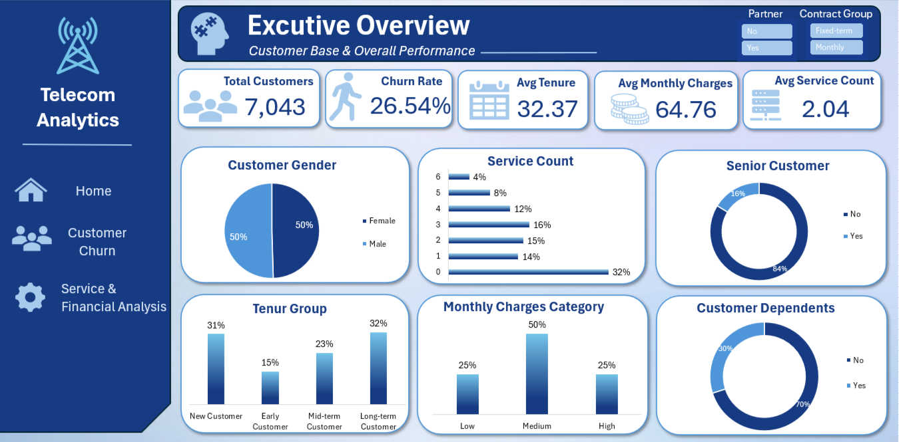

# Telecom Customer Churn Analysis — Excel Project

[

## Table of Contents

1. [Project Introduction](#1-project-introduction)
2. [Project Overview](#2-project-overview)
3. [Business Purpose](#3-business-purpose)
4. [Project Workflow](#4-project-workflow)
5. [Dashboard Screenshots](#5-dashboard-screenshots)
6. [Key Findings & Insights](#6-key-findings--insights)
7. [Business Recommendations](#7-business-recommendations)
8. [Key Definitions](#8-key-definitions)
9. [Tools & Technologies](#9-tools--technologies)
10. [References](#10-references)
11. [Conclusion](#11-conclusion)

## 1. Project Introduction

This project analyzes customer churn for a telecommunications provider using Excel. The analysis combines data cleaning, feature preparation, PivotTable summaries, interactive dashboard development, and churn interpretation to identify the main factors associated with customers leaving the service.

The project is designed as a portfolio example for a data analyst role and demonstrates a complete Excel workflow from raw data preparation to actionable business conclusions.

## 2. Project Overview

| Item | Description |
|---|---|
| Business Domain | Telecommunications customer retention |
| Dataset | IBM Telco Customer Churn dataset |
| Main Objective | Identify customer segments and service factors associated with churn |
| Primary Output | Executive overview and customer behavior dashboards |
| Tools Used | Microsoft Excel, Power Query, PivotTables, PivotCharts, Slicers, Analysis ToolPak |

## 3. Business Purpose

Customer churn directly affects recurring revenue and increases customer acquisition costs. Understanding which customers are most likely to leave enables the business to:

- Detect at-risk customer segments early.
- Improve customer retention programs.
- Prioritize profitable service offerings.
- Improve marketing and sales resource allocation.
- Develop targeted initiatives for contract, payment, and support strategies.

## 4. Project Workflow

1. **Data Cleaning using Power Query**
   - Standardized imported values.
   - Removed or treated inconsistent records.
   - Prepared fields for PivotTable and dashboard analysis.

2. **Feature Engineering**
   - Added or classified fields used for customer, contract, tenure, and service analysis.
   - Organized customer charges into meaningful categories.

3. **PivotTables and PivotCharts**
   - Summarized churn by contract, tenure, payment method, internet service, demographics, and service bundle.
   - Used PivotTables to support segment comparisons and identify churn patterns.

4. **Interactive Dashboard Development**
   - Added slicers for filtering dashboard views.
   - Built clear visualizations for executives and retention teams.

## 5. Dashboard Screenshots

### Executive Overview

*The executive dashboard summarizes overall customer volume, retained and churned customers, revenue-related metrics, and high-level business indicators.*

### Customer Churn Analysis

*The churn dashboard compares churn outcomes by contract type, tenure, payment method, demographic profile, and add-on service usage.*

### Service &amp; Financial Analysis

*The service and financial dashboard highlights internet services, add-on subscriptions, monthly charges, and their relationship to customer retention.*

## 6. Key Findings &amp; Insights

| Finding | Supporting Metrics |
|---|---|
| Contract commitment strongly affects retention | Month-to-month churn: **42.71%** vs. one-year: **11.27%** vs. two-year: **2.83%** |
| New customers are the highest-risk segment | Customers in the new tenure segment have **46.82%** churn |
| Long-tenure customers are more likely to remain | Long-tenure customers have **11.15%** churn |
| Payment method is related to churn behavior | Electronic Check: **45.3%** churn; automatic payment methods: **15.2%–16.7%** churn |
| Senior customers represent a higher-risk segment | Senior-citizen churn: **41.0%** vs. non-senior churn: **23.61%** |
| Internet service type affects retention | Fiber Optic: **41.89%**; DSL: **18.96%**; no Internet: **7.40%** |
| Customer financial profile is linked to churn | High-charge and medium-charge customers: **32.88%** and **31.02%** churn vs. **11.24%** for low-charge customers |
| Add-on services improve retention in the reported data | One add-on: **45.76%** churn; six add-ons: **5.28%** churn |

> **Interpretation note:** These findings describe observed relationships in the dataset. They should not be interpreted as proof that one factor alone causes customer churn.

## 7. Business Recommendations

1. **Create an early-tenure intervention program** with onboarding calls and proactive support to reduce the high churn observed among new customers.
2. **Promote long-term contracts** using loyalty benefits and renewal incentives without relying only on direct discounts.
3. **Encourage customers to use automatic payment methods** and improve the customer experience around Electronic Check payments.
4. **Develop targeted retention campaigns** for senior citizens, customers without partners, and customers without dependents.
5. **Investigate Fiber Optic churn drivers** by analyzing service quality, pricing, and customer feedback.
6. **Review the pricing structure** to ensure that high-charge plans provide sufficient perceived value.
7. **Build service bundles** around combinations that show better retention rather than focusing only on the number of add-on services.
8. **Implement proactive monitoring** for customers with multiple risk factors, such as month-to-month contracts combined with high monthly charges.

## 8. Key Definitions

- **Churn Rate:** Percentage of customers who leave within the observed period.
- **Retention Rate:** Percentage of customers who remain subscribed.
- **Tenure:** Length of time a customer has remained with the company.
- **Monthly Charges:** Amount billed to a customer in a typical month.
- **Add-on Services:** Extra services purchased by a customer in addition to a base plan, such as security or support services.
- **Senior citizens:** These are customers above the age of 49.
- **Fiber Optic / DSL:** Broadband technology types included in the dataset.

## 9. Tools &amp; Technologies

- Microsoft Excel
- Power Query
- PivotTables
- PivotCharts
- Slicers
- Excel Analysis ToolPak
- Microsoft 365
- IBM Telco Customer Churn dataset

## 10. References

- **Dataset source:** IBM Telco Customer Churn sample data
- **Official documentation:** [IBM Cognos Analytics - Telco customer churn](https://www.ibm.com/docs/en/cognos-analytics/11.2.x?topic=samples-telco-customer-churn)
- **Official IBM sample repository:** [IBM Telco Customer Churn on GitHub](https://github.com/IBM/telco-customer-churn-on-icp4d)
- **Dataset mirror:** [Mendeley Data — Telco Customer Churn](https://data.mendeley.com/datasets/phsxg9ssrf/1)

## 11. Conclusion

This analysis provides a clear view of customer churn patterns, identifies segments with elevated churn risk, and highlights practical actions for improving retention. Month-to-month contracts, short tenure, Electronic Check payments, Fiber Optic service, and lower add-on usage are the most important patterns visible in the report.

The Excel dashboard transforms the underlying customer data into decision-ready views for management, sales, customer success, and service teams. The recommendations are intended to support targeted retention strategies rather than broad or reactive interventions.

> **Dashboard data source:** `overview.png`, `churn analysis.png`, and `service &amp; financial analysis.png`
> 
> **Workbook:** `Telecom.xlsx`
